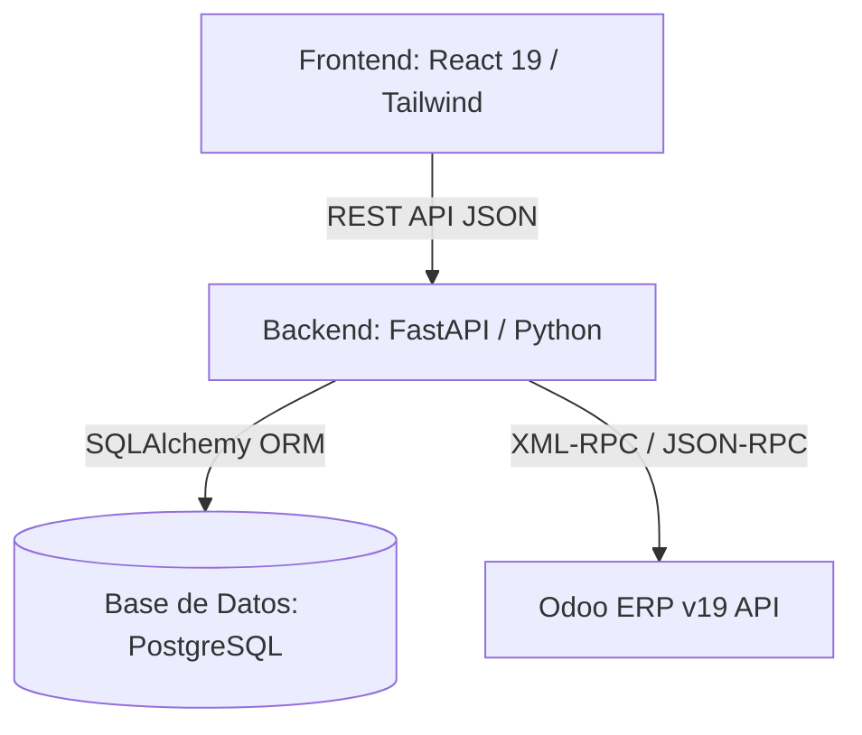

# Arquitectura del Sistema y Modelo de Datos - dev_produccion

Este documento describe la arquitectura de software, la distribución de componentes y el diseño lógico de la base de datos PostgreSQL para el sistema de control de producción de **Nutriestacion SAS**.

**Última actualización:** Septiembre 2026

---

## 1. Arquitectura de Software

La aplicación sigue una arquitectura de tres capas desemparejada, permitiendo rapidez en la interfaz de usuario y robustez en la integración con el ERP.



### A. Frontend (React 19 + Vite)
El cliente frontend está estructurado como una Single Page Application (SPA), optimizada para pantallas táctiles en cocina y básculas en bodega:
*   **Routing:** `react-router-dom` (v7) para separar la administración de los accesos de cocina y bodega.
*   **UI Components:** Tailwind CSS con Shadcn UI para una interfaz moderna, limpia y responsiva. El sistema está diseñado para ser **multiplataforma** (responsive): funciona en pantallas de escritorio, tablets y dispositivos móviles táctiles.
*   **State Management:** Context API de React para manejar el estado de las pesadas múltiples y taras activas en bodega.

### B. Backend (FastAPI)
El backend actúa como pasarela segura de lógica de negocio y comunicación con Odoo:
*   **FastAPI:** Framework asíncrono de alto rendimiento con validación de datos estricta mediante `Pydantic`.
*   **ORM:** `SQLAlchemy` para la persistencia relacional local en PostgreSQL.
*   **Odoo Client:** Módulo de comunicación XML-RPC/JSON-RPC (`odoo_client.py`) que encapsula las llamadas al ERP. Usa notación polaca (prefija) correcta para la construcción de dominios de búsqueda de Odoo.

---

## 2. Estructura de Directorios

```
dev_produccion/
├── backend/
│   ├── app/
│   │   ├── api/
│   │   │   └── endpoints/
│   │   │       ├── auth.py           # Autenticación y JWT
│   │   │       ├── planner.py        # Planificador de Menús y Órdenes de Fabricación
│   │   │       ├── dispatch.py       # Despacho a Cocina y Producción Establecida
│   │   │       ├── dispatch_day.py   # Despacho Diario (Puntos de Servicio)
│   │   │       ├── inventory.py      # Inventario Físico
│   │   │       ├── recipes.py        # Recetas y Pruebas de Platos
│   │   │       └── users.py          # Gestión de Usuarios y Roles
│   │   ├── core/           # Configuración global, seguridad (JWT) y conexión a DB
│   │   ├── models/         # Modelos SQLAlchemy (PostgreSQL)
│   │   ├── schemas/        # Esquemas Pydantic para validación de entrada/salida
│   │   ├── services/       # Lógica de negocio (odoo_client.py, calculos_recetas.py)
│   │   └── main.py         # Punto de entrada + auto-migración de columnas
│   └── requirements.txt
├── frontend/
│   ├── src/
│   │   ├── components/     # Componentes compartidos (modales, taras, animaciones)
│   │   ├── pages/
│   │   │   ├── ClientDispatch/       # Despacho por Cliente (Puntos de Servicio)
│   │   │   ├── ServicePoints/        # Despacho de Planta (Puntos de Servicio)
│   │   │   ├── Dashboard.jsx
│   │   │   ├── Planner.jsx
│   │   │   ├── PlannerManufacturingOrders.jsx
│   │   │   ├── Dispatch.jsx
│   │   │   ├── DispatchDayExecution.jsx
│   │   │   ├── EstablishProduction.jsx
│   │   │   ├── Inventory.jsx
│   │   │   ├── Recipes.jsx
│   │   │   ├── Permissions.jsx       # Gestor de Permisos de Acceso por Módulo
│   │   │   └── Users.jsx
│   │   ├── services/       # Clientes HTTP hacia la API FastAPI
│   │   ├── App.jsx         # Enrutador y layout global con guards de permisos
│   │   └── main.jsx
│   └── package.json
├── docs/                   # Documentación técnica del sistema
├── doc/                    # Guía de despliegue y contexto IA
└── antigravity_tests/      # Scripts de prueba, parches y backups (no va a producción)
```

---

## 3. Modelo de Datos (PostgreSQL)

### A. Gestión de Accesos

#### Tabla: `usuarios`
Almacena usuarios locales y sus permisos granulares por módulo.
```sql
CREATE TABLE usuarios (
    id SERIAL PRIMARY KEY,
    username VARCHAR(100) UNIQUE NOT NULL,
    nombre VARCHAR(150) NOT NULL,
    password_hash VARCHAR(255) NULL,
    rol VARCHAR(50) NOT NULL,        -- 'admin', 'cocina', 'bodega', 'supervisor'
    odoo_user_id INTEGER UNIQUE NULL,
    permisos JSON DEFAULT '{}',      -- {"planner": true, "dispatch": true, ...}
    activo BOOLEAN DEFAULT TRUE,
    created_at TIMESTAMP DEFAULT CURRENT_TIMESTAMP
);
```

> **Nota `permisos`:** Es un campo JSON que almacena flags booleanos por módulo. Se gestiona desde `Permissions.jsx` y permite otorgar o revocar acceso granular a cada sección del sistema (Planificador, Despacho, Puntos de Servicio, etc.) sin cambiar el rol principal del usuario.

#### Tabla: `roles`
```sql
CREATE TABLE roles (
    id SERIAL PRIMARY KEY,
    nombre VARCHAR(50) UNIQUE NOT NULL  -- 'admin', 'cocina', 'bodega', 'supervisor'
);
```

### B. Módulo de Recetas y Pruebas

#### Tabla: `recetas`
```sql
CREATE TABLE recetas (
    id SERIAL PRIMARY KEY,
    nombre VARCHAR(255) NOT NULL,
    base_porciones NUMERIC NOT NULL DEFAULT 100,
    proteina_dominante VARCHAR(100) NOT NULL,
    categoria_odoo_id INTEGER NOT NULL,
    subcategoria_odoo_id INTEGER NULL,
    odoo_product_id INTEGER UNIQUE NULL,
    bom_cost FLOAT DEFAULT 0.0,      -- Costo calculado de la BoM (columna agregada via ALTER)
    is_active BOOLEAN DEFAULT TRUE,
    created_at TIMESTAMP DEFAULT CURRENT_TIMESTAMP
);
```

#### Tabla: `receta_ingredientes`
```sql
CREATE TABLE receta_ingredientes (
    id SERIAL PRIMARY KEY,
    receta_id INTEGER REFERENCES recetas(id) ON DELETE CASCADE,
    odoo_product_id INTEGER NOT NULL,
    cantidad_proporcional NUMERIC NOT NULL,
    unidad_medida VARCHAR(50) NOT NULL
);
```

#### Tabla: `receta_pruebas`
```sql
CREATE TABLE receta_pruebas (
    id SERIAL PRIMARY KEY,
    nombre_plato VARCHAR(255) NOT NULL,
    base_prueba NUMERIC NOT NULL,
    base_registro_target NUMERIC NOT NULL,
    estado VARCHAR(50) NOT NULL DEFAULT 'planificada',
    fecha_prueba DATE NOT NULL,
    created_at TIMESTAMP DEFAULT CURRENT_TIMESTAMP
);
```

### C. Módulo Planificador de Menú

#### Tabla: `turnos`
```sql
CREATE TABLE turnos (
    id SERIAL PRIMARY KEY,
    nombre VARCHAR(100) UNIQUE NOT NULL,
    franja_horaria VARCHAR(50)
);
```

#### Tabla: `tipos_menu`
Gestiona los tipos de menú. Los menús generados por `nueva_produccion` (órdenes manuales) reciben automáticamente el sufijo `" (Manual)"` para que queden en un `OrdenProduccionDia` aislado y no se mezclen con la producción normal.
```sql
CREATE TABLE tipos_menu (
    id SERIAL PRIMARY KEY,
    nombre VARCHAR(100) UNIQUE NOT NULL  -- ej: "Almuerzo Tipo 1", "Almuerzo Tipo 1 (Manual)"
);
```

#### Tabla: `clientes`
```sql
CREATE TABLE clientes (
    id SERIAL PRIMARY KEY,
    nombre VARCHAR(150) UNIQUE NOT NULL,
    tipo VARCHAR(50) NOT NULL  -- 'porcentaje' o 'cantidad'
);
```

#### Tabla: `orden_produccion_dias` (**Núcleo del sistema**)
Cada fila representa un menú de un día, turno y tipo de menú específico. Es la unidad de aislamiento que impide mezclar órdenes entre turnos o entre producción normal y manual.
```sql
CREATE TABLE orden_produccion_dias (
    id SERIAL PRIMARY KEY,
    fecha DATE NOT NULL,
    turno_id INTEGER REFERENCES turnos(id) ON DELETE SET NULL,
    tipo_menu_id INTEGER REFERENCES tipos_menu(id) ON DELETE SET NULL,
    ruta_asignada VARCHAR(255) NULL,             -- Nombre de la MO en Odoo (ej: NUT/FABAL/01546)
    produccion_establecida BOOLEAN DEFAULT FALSE, -- TRUE cuando el despacho fue confirmado
    created_at TIMESTAMP WITH TIME ZONE DEFAULT NOW(),
    UNIQUE(fecha, turno_id, tipo_menu_id)
);
-- Columna agregada via ALTER TABLE en main.py:
-- ALTER TABLE orden_produccion_dias ADD COLUMN IF NOT EXISTS ruta_asignada VARCHAR(255);
```

> **Diseño de Separación de Órdenes Manuales:**
> La combinación `(fecha, turno_id, tipo_menu_id)` es la clave de unicidad. Al crear una orden manual con `nueva_produccion`, el endpoint asigna el tipo de menú como `"<NombreOriginal> (Manual)"`, forzando la creación de un nuevo registro `OrdenProduccionDia` en lugar de fusionarse con la producción normal del mismo turno y fecha.

#### Tabla: `orden_produccion_items`
```sql
CREATE TABLE orden_produccion_items (
    id SERIAL PRIMARY KEY,
    orden_dia_id INTEGER REFERENCES orden_produccion_dias(id) ON DELETE CASCADE,
    plato_nombre VARCHAR(255) NOT NULL,
    tipo VARCHAR(100) NOT NULL,  -- 'SOPA', 'FUERTE #1', 'GUARNICION #1', etc.
    total NUMERIC NOT NULL DEFAULT 0,
    cantidades_clientes JSONB NULL,   -- {cliente: {cant, pct}} — distribución por cliente
    odoo_product_id INTEGER NULL      -- ID del plato en Odoo (columna agregada via ALTER)
);
```

### D. Módulo de Despacho

#### Tabla: `historial_despachos`
```sql
CREATE TABLE historial_despachos (
    id SERIAL PRIMARY KEY,
    orden_dia_id INTEGER REFERENCES orden_produccion_dias(id),
    estado VARCHAR(50) NOT NULL DEFAULT 'borrador',
    grupo_nombre VARCHAR(255),   -- Agregada via ALTER
    creado_por INTEGER,          -- Agregada via ALTER (FK a usuarios.id)
    novedades TEXT,              -- Agregada via ALTER
    fecha_despacho DATE NOT NULL DEFAULT CURRENT_DATE
);
```

#### Tabla: `despacho_cliente_pesajes`
```sql
CREATE TABLE despacho_cliente_pesajes (
    id SERIAL PRIMARY KEY,
    historial_despacho_id INTEGER REFERENCES historial_despachos(id) ON DELETE CASCADE,
    cliente_nombre VARCHAR(150),
    producto_nombre VARCHAR(255),
    peso_bruto NUMERIC,
    peso_tara NUMERIC DEFAULT 0.0,
    peso_neto NUMERIC,
    porciones_seleccionadas JSON  -- Agregada via ALTER
);
```

### E. Módulo de Inventario Físico

#### Tabla: `inventarios`
```sql
CREATE TABLE inventarios (
    id SERIAL PRIMARY KEY,
    nombre_ajuste_odoo VARCHAR(255) NOT NULL,
    fecha_programada TIMESTAMP NOT NULL,
    usuario_asignado_id INTEGER REFERENCES usuarios(id) ON DELETE SET NULL,
    estado VARCHAR(50) NOT NULL DEFAULT 'programado',
    odoo_inventory_adjustment_id INTEGER NULL,
    created_at TIMESTAMP DEFAULT CURRENT_TIMESTAMP
);
```

#### Tabla: `inventario_items`
```sql
CREATE TABLE inventario_items (
    id SERIAL PRIMARY KEY,
    inventario_id INTEGER REFERENCES inventarios(id) ON DELETE CASCADE,
    odoo_product_id INTEGER NOT NULL,
    cantidad_teorica NUMERIC NOT NULL DEFAULT 0.0,
    cantidad_fisica NUMERIC NOT NULL DEFAULT 0.0,
    ubicacion_fisica VARCHAR(150) NOT NULL,
    novedad TEXT NULL
);
```

---

## 4. Módulo de Permisos de Acceso

El sistema implementa un sistema de permisos granular de dos niveles:

### Nivel 1: Rol del Usuario
Define el perfil general: `admin`, `cocina`, `bodega`, `supervisor`.

### Nivel 2: Permisos Específicos por Módulo (campo `permisos` en `usuarios`)
El campo JSON `permisos` en la tabla de usuarios almacena un objeto con flags booleanos. El administrador los gestiona desde `Permissions.jsx` (pantalla de "Control de Acceso").

**Grupos de Módulos documentados:**

| Grupo | Clave de Permiso | Módulo |
|---|---|---|
| PLANIFICACIÓN | `planner` | Planificador de Menús |
| PLANIFICACIÓN | `manufacturing_orders` | Órdenes de Fabricación |
| DESPACHO Y PRODUCCIÓN | `dispatch` | Despacho a Cocina |
| DESPACHO Y PRODUCCIÓN | `establish_production` | Producción Establecida |
| DESPACHO Y PRODUCCIÓN | `dispatch_day` | Despacho de Planta |
| PUNTOS DE SERVICIO | `service_points_dispatch` | Despacho en Puntos de Servicio |
| PUNTOS DE SERVICIO | `service_points_plant_dispatch` | Despacho de Planta (Puntos de Servicio) |
| RECETAS | `recipes` | Módulo de Recetas |
| INVENTARIO | `inventory` | Toma de Inventario Físico |
| ADMINISTRACIÓN | `users` | Gestión de Usuarios |
| ADMINISTRACIÓN | `permissions` | Control de Acceso |
| ADMINISTRACIÓN | `settings` | Configuración del Sistema |

---

## 5. Integración con Odoo — Dominios de Búsqueda (Notación Polaca)

Odoo usa **notación polaca prefija** para sus dominios de búsqueda. Una falla en la construcción del dominio causa que Odoo evalúe condiciones parciales e ignore el resto, devolviendo resultados incorrectos.

### Regla de Construcción Correcta:
Para `N` condiciones unidas por un mismo operador, se necesitan `N-1` operadores al inicio:

```python
# CORRECTO: 3 condiciones con AND => 2 operadores '&' al inicio
domain = ['&', '&',
    ('state', '!=', 'cancel'),
    ('name', 'not like', 'HIDE/FAB/%'),
    ('origin', 'in', ['NUT-DIA-5', 'Reabastecimiento manual (NUT-DIA-5)'])
]

# INCORRECTO (causa silenciosa): solo 1 '&' para 3 condiciones
domain = ['&',
    ('state', '!=', 'cancel'),
    ('name', 'not like', 'HIDE/FAB/%'),
    ('origin', 'in', [...])  # <-- ignorado
]
```

El método `get_day_components` en `odoo_client.py` construye el dominio dinámicamente contando cuántas condiciones hay y aplicando `(N-1)` operadores `&` al inicio, garantizando que todos los filtros sean procesados.

---

## 6. Referencia de Endpoints Clave

### Módulo Planner (`/api/planner/ordenes-fabricacion/`)

| Método | Ruta | Descripción |
|--------|------|-------------|
| `GET`  | `/ordenes-fabricacion` | Lista todas las órdenes con `turno`, `tipo_menu` e `items`. Incluye `produccion_establecida`. |
| `POST` | `/ordenes-fabricacion/manual` | Crea manualmente una orden de producción para una fecha, turno y menú específicos. |
| `POST` | `/ordenes-fabricacion/nueva-produccion` | Agrega platos/materiales manualmente al día. Asigna sufijo `(Manual)` al tipo de menú para aislamiento. |
| `POST` | `/ordenes-fabricacion/crear-productos-odoo` | **Paso 1 Wizard.** Crea/actualiza el producto del menú en Odoo con su BoM. |
| `POST` | `/ordenes-fabricacion/crear-ordenes-fabricacion-odoo` | **Paso 2 Wizard.** Crea y confirma la MO principal en Odoo. Guarda `ruta_asignada` en BD local. |
| `POST` | `/ordenes-fabricacion/reabastecer-componentes-odoo` | **Paso 3 Wizard.** Lanza reabastecimiento por cada plato. Elimina solo MOs con `origin` exacto `NUT-DIA-{dia.id}`. |
| `POST` | `/ordenes-fabricacion/reparar-ruta-mos` | Endpoint de reparación para MOs sin `picking_type_id`. |

### Módulo Despacho (`/api/dispatch/`)

| Método | Ruta | Descripción |
|--------|------|-------------|
| `GET`  | `/day-components/{fecha}` | Obtiene los componentes de las MOs de Odoo para una fecha. Aplica dominio Odoo con notación polaca correcta. |
| `POST` | `/establecer-produccion` | Distribuye consumos a las MOs de Odoo del menú seleccionado (filtro por prefijo de ruta). Marca `produccion_establecida = TRUE`. |
| `GET`  | `/establecer-produccion/{fecha}` | Consulta resultados de producción de una fecha en Odoo. |

### Módulo Despacho Diario (`/api/dispatch-day/`)

| Método | Ruta | Descripción |
|--------|------|-------------|
| `GET`  | `/day-components/{fecha}` | Obtiene componentes filtrados por `dia_id` local para aislar por turno y menú. |
| `POST` | `/save-dispatch` | Guarda el estado del despacho diario de un día. |
| `GET`  | `/history/{fecha}` | Historial de despacho de una fecha. |
