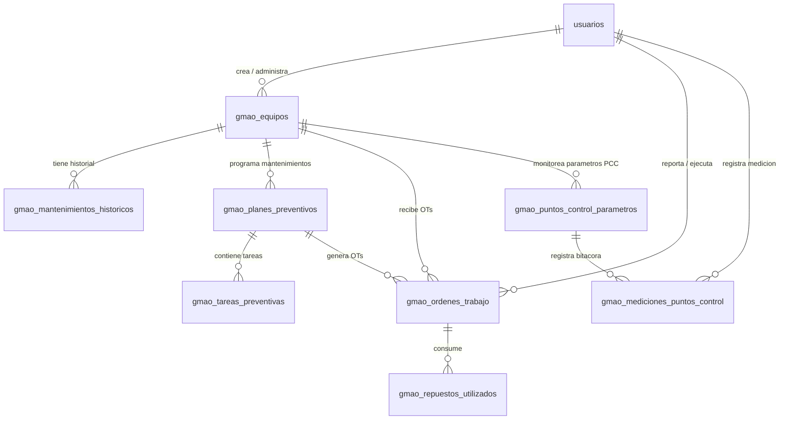

# Módulo "Procesos y Mantenimientos" (GMAO / HACCP) — Nutriestacion
## Documento 3: Stack Tecnológico, Modelo de Datos PostgreSQL y Diagrama ERD (v2)

**Proyecto:** `dev_produccion`  
**Base de Datos:** PostgreSQL (`dev_produccion`)  
**ORM:** SQLAlchemy (Python 3.12)  
**Validador:** Pydantic v2  

---

### 1. Stack Tecnológico Integrado en `dev_produccion`

El módulo utiliza **exclusivamente las mismas tecnologías, librerías y patrones de diseño** del proyecto existente `dev_produccion`:

```
┌────────────────────────────────────────────────────────────────────────┐
│                        FRONTEND (SPA Multiplataforma)                  │
│  React 19 | Vite | Tailwind CSS | Shadcn UI | Lucide Icons | HTML5 QR    │
└───────────────────────────────────┬────────────────────────────────────┘
                                    │ HTTP REST API (JSON) / JWT Auth
┌───────────────────────────────────▼────────────────────────────────────┐
│                        BACKEND (API Asíncrona)                         │
│  FastAPI (Python 3.12) | Pydantic v2 | SQLAlchemy ORM | APScheduler      │
└─────────────────┬─────────────────┬──────────────────┬─────────────────┘
                  │                 │                  │
    PostgreSQL    │      Odoo API   │   WhatsApp API   │   SMTP / Mail
┌─────────────────▼──┐   ┌──────────▼───────┐ ┌────────▼────────┐ ┌────────▼────────┐
│  BD PostgreSQL     │   │  Odoo ERP v19    │ │ Twilio / Meta   │ │ Servidor Email  │
│  (dev_produccion)  │   │  (XML-RPC/JSON)  │ │ Business API    │ │ (Notif. T-1)    │
└────────────────────┘   └──────────────────┘ └─────────────────┘ └─────────────────┘
```

---

### 2. Modelo de Datos PostgreSQL (Integración con Tablas Existentes)

El nuevo módulo extiende el esquema de PostgreSQL de `dev_produccion` conectándose directamente con la tabla existente `usuarios` e introduciendo las **8 nuevas tablas relacionales**:

#### **A. Reutilización de Tabla Existente: `usuarios`**
```sql
-- Estructura de la tabla existente en dev_produccion (No se recrea, solo se usan sus IDs)
CREATE TABLE IF NOT EXISTS usuarios (
    id SERIAL PRIMARY KEY,
    username VARCHAR(100) UNIQUE NOT NULL,
    nombre VARCHAR(150) NOT NULL,
    password_hash VARCHAR(255) NULL,
    rol VARCHAR(50) NOT NULL,        -- 'admin', 'cocina', 'bodega', 'supervisor'
    odoo_user_id INTEGER UNIQUE NULL,
    permisos JSON DEFAULT '{}',      -- Se extienden claves: gmao_assets, gmao_preventive, gmao_workorders, gmao_control_points, gmao_checklists, gmao_dashboard
    activo BOOLEAN DEFAULT TRUE,
    created_at TIMESTAMP DEFAULT CURRENT_TIMESTAMP
);
```

---

#### **B. Nuevas Tablas del Módulo Procesos y Mantenimientos**

##### 1. Tabla: `gmao_equipos` (Inventario de Activos)
```sql
CREATE TABLE gmao_equipos (
    id SERIAL PRIMARY KEY,
    codigo_activo VARCHAR(50) UNIQUE NOT NULL, -- ej. 'EQ-PROC-001'
    nombre VARCHAR(150) NOT NULL,
    categoria VARCHAR(100) NOT NULL,            -- 'Térmico', 'Mecánico', 'Procesamiento', 'Medición', 'Extracción'
    marca VARCHAR(100),
    modelo VARCHAR(100),
    numero_serie VARCHAR(100),
    ubicacion_planta VARCHAR(150) NOT NULL,     -- 'Bodega Secos', 'Cocina Caliente', 'Área Envasado'
    especificaciones_tecnicas JSONB DEFAULT '{}',-- Voltaje, potencia, refrigerante, etc.
    criticidad_proceso VARCHAR(20) DEFAULT 'Media',-- 'Baja', 'Media', 'Alta', 'Crítica'
    estado VARCHAR(50) DEFAULT 'Operativo',     -- 'Operativo', 'En Preventivo', 'En Falla', 'Fuera de Servicio'
    fecha_adquisicion DATE,
    garantia_hasta DATE,
    qr_code_url TEXT,                           -- Enlace o SVG Base64 del código QR
    creado_por INTEGER REFERENCES usuarios(id) ON DELETE SET NULL,
    created_at TIMESTAMP WITH TIME ZONE DEFAULT NOW()
);
```

##### 2. Tabla: `gmao_mantenimientos_historicos` (Carga Retroactiva)
```sql
CREATE TABLE gmao_mantenimientos_historicos (
    id SERIAL PRIMARY KEY,
    equipo_id INTEGER REFERENCES gmao_equipos(id) ON DELETE CASCADE,
    fecha_intervencion DATE NOT NULL,
    tipo_mantenimiento VARCHAR(50) NOT NULL,    -- 'Preventivo', 'Correctivo', 'Calibración'
    descripcion_trabajo TEXT NOT NULL,
    tecnico_proveedor VARCHAR(150),
    costo_total NUMERIC(10,2) DEFAULT 0.00,
    repuestos_cambiados TEXT,
    es_retroactivo BOOLEAN DEFAULT TRUE,         -- Flag para auditoría
    created_at TIMESTAMP WITH TIME ZONE DEFAULT NOW()
);
```

##### 3. Tabla: `gmao_planes_preventivos` (Programación Recurrente)
```sql
CREATE TABLE gmao_planes_preventivos (
    id SERIAL PRIMARY KEY,
    equipo_id INTEGER REFERENCES gmao_equipos(id) ON DELETE CASCADE,
    titulo_plan VARCHAR(200) NOT NULL,
    frecuencia_dias INTEGER NOT NULL,            -- 1 (Diario), 7 (Semanal), 30 (Mensual), etc.
    frecuencia_nombre VARCHAR(50) NOT NULL,      -- 'Diario', 'Semanal', 'Mensual', 'Semestral', 'Anual'
    duracion_estimada_min INTEGER DEFAULT 60,
    responsables_rol VARCHAR(50) NOT NULL,       -- 'Técnico Mantenimiento', 'Supervisor QA', 'Cocinero'
    usuario_asignado_id INTEGER REFERENCES usuarios(id) ON DELETE SET NULL,
    instructivo_sop TEXT,                        -- Guía de ejecución paso a paso
    proxima_fecha DATE NOT NULL,
    ultima_fecha DATE,
    activo BOOLEAN DEFAULT TRUE,
    created_at TIMESTAMP WITH TIME ZONE DEFAULT NOW()
);
```

##### 4. Tabla: `gmao_tareas_preventivas` (Checklist del Plan)
```sql
CREATE TABLE gmao_tareas_preventivas (
    id SERIAL PRIMARY KEY,
    plan_id INTEGER REFERENCES gmao_planes_preventivos(id) ON DELETE CASCADE,
    orden INTEGER NOT NULL DEFAULT 1,
    descripcion VARCHAR(255) NOT NULL,
    tipo_respuesta VARCHAR(50) DEFAULT 'boolean',-- 'boolean' (OK/FAIL), 'numeric' (Medición), 'text'
    valor_minimo NUMERIC NULL,
    valor_maximo NUMERIC NULL
);
```

##### 5. Tabla: `gmao_ordenes_trabajo` (OTs Correctivas / Preventivas)
```sql
CREATE TABLE gmao_ordenes_trabajo (
    id SERIAL PRIMARY KEY,
    codigo_ot VARCHAR(50) UNIQUE NOT NULL,      -- ej. 'OT-2026-0089'
    equipo_id INTEGER REFERENCES gmao_equipos(id) ON DELETE CASCADE,
    plan_preventivo_id INTEGER REFERENCES gmao_planes_preventivos(id) ON DELETE SET NULL,
    tipo VARCHAR(50) NOT NULL,                  -- 'Preventiva', 'Correctiva', 'Emergencia'
    prioridad VARCHAR(20) DEFAULT 'Media',       -- 'Baja', 'Media', 'Alta', 'Crítica'
    estado VARCHAR(50) DEFAULT 'Pendiente',      -- 'Pendiente', 'En Proceso', 'Pausada', 'Completada', 'Cancelada'
    descripcion_falla TEXT NOT NULL,
    reportado_por INTEGER REFERENCES usuarios(id) ON DELETE SET NULL,
    tecnico_asignado_id INTEGER REFERENCES usuarios(id) ON DELETE SET NULL,
    fecha_reporte TIMESTAMP WITH TIME ZONE DEFAULT NOW(),
    fecha_inicio TIMESTAMP WITH TIME ZONE,
    fecha_cierre TIMESTAMP WITH TIME ZONE,
    tiempo_parada_horas NUMERIC(6,2) DEFAULT 0.00,
    solucion_aplicada TEXT,
    causa_raiz VARCHAR(150),
    foto_falla_url TEXT,
    foto_solucion_url TEXT,
    firma_conformidad_url TEXT,
    costo_mano_obra NUMERIC(10,2) DEFAULT 0.00,
    costo_repuestos NUMERIC(10,2) DEFAULT 0.00,
    costo_total NUMERIC(10,2) DEFAULT 0.00
);
```

##### 6. Tabla: `gmao_repuestos_utilizados` (Insumos consumidos)
```sql
CREATE TABLE gmao_repuestos_utilizados (
    id SERIAL PRIMARY KEY,
    ot_id INTEGER REFERENCES gmao_ordenes_trabajo(id) ON DELETE CASCADE,
    odoo_product_id INTEGER NULL,               -- ID de producto en Odoo si proviene del catálogo
    nombre_repuesto VARCHAR(150) NOT NULL,
    cantidad NUMERIC(10,2) NOT NULL DEFAULT 1.00,
    costo_unitario NUMERIC(10,2) DEFAULT 0.00,
    costo_subtotal NUMERIC(10,2) DEFAULT 0.00
);
```

##### 7. Tabla: `gmao_puntos_control_parametros` (Configuración Paramétrica PCC)
```sql
CREATE TABLE gmao_puntos_control_parametros (
    id SERIAL PRIMARY KEY,
    equipo_id INTEGER REFERENCES gmao_equipos(id) ON DELETE CASCADE,
    nombre_punto VARCHAR(150) NOT NULL,          -- ej. 'Temperatura de Cocción Cocina Caliente'
    variable_medida VARCHAR(50) NOT NULL,        -- 'Temperatura', 'Tiempo', 'Presión', 'Concentración ppm'
    unidad_medida VARCHAR(20) NOT NULL,          -- '°C', '°F', 'min', 'PSI', 'ppm'
    limite_inferior_critico NUMERIC(8,2) NULL,
    limite_superior_critico NUMERIC(8,2) NULL,
    valor_objetivo NUMERIC(8,2) NULL,
    frecuencia_medicion_horas INTEGER DEFAULT 4,
    accion_correctiva_sugerida TEXT NOT NULL,
    activo BOOLEAN DEFAULT TRUE,
    created_at TIMESTAMP WITH TIME ZONE DEFAULT NOW()
);
```

##### 8. Tabla: `gmao_mediciones_puntos_control` (Bitácora de Mediciones)
```sql
CREATE TABLE gmao_mediciones_puntos_control (
    id SERIAL PRIMARY KEY,
    punto_control_id INTEGER REFERENCES gmao_puntos_control_parametros(id) ON DELETE CASCADE,
    equipo_id INTEGER REFERENCES gmao_equipos(id) ON DELETE CASCADE,
    valor_medido NUMERIC(8,2) NOT NULL,
    dentro_de_rango BOOLEAN NOT NULL,
    accion_correctiva_aplicada TEXT,             -- Requerido obligatoriamente si dentro_de_rango es FALSE
    registrado_por INTEGER REFERENCES usuarios(id) ON DELETE SET NULL,
    foto_evidencia_url TEXT,
    fecha_medicion TIMESTAMP WITH TIME ZONE DEFAULT NOW()
);
```

---

### 3. Diagrama Entidad-Relación (Mermaid ERD)


