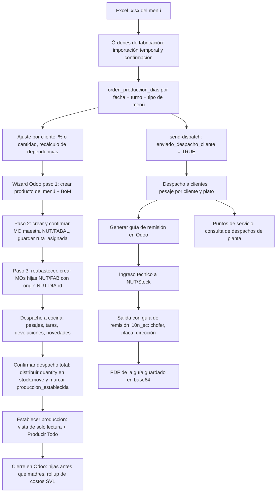

# Migración de Contexto a Claude — `dev_produccion` (Nutriestacion SAS)

**Fecha de corte:** 24 de octubre de 2026 (fase de migración cerrada; ver §18)
**Propósito:** Documento maestro de traspaso. Le da a Claude **todo el contexto** del proyecto: negocio, arquitectura, estado real del código, reglas críticas, deuda técnica y forma de trabajo con el usuario. Funciona como **índice** de los demás `.md` de `docs/` y como **fe de erratas**, porque esos documentos son de septiembre de 2026 y el código ha cambiado desde entonces.

> **Regla de oro para Claude:** si este documento y otro `.md` no coinciden, **gana este documento** (se verificó contra el código el 24-oct-2026, con lectura directa de `models.py`, `odoo_client.py`, los endpoints de `planner.py`/`dispatch.py`/`dispatch_cliente.py` y la estructura de `PlannerManufacturingOrders.jsx`; ver §18). Si este documento y el **código** no coinciden, **gana el código**: revísalo antes de editar. **Esta es la única fuente de contexto que debe usarse para trabajar en el proyecto a partir de ahora**; los demás `.md` de `docs/` quedan como referencia histórica y de fórmulas, subordinados a este documento y al código.

---

## 0. Orden de lectura recomendado

| # | Documento | Qué aporta | Vigencia |
|---|---|---|---|
| 1 | **`docs/migracion_claude241026.md`** (este) | Mapa general, estado real y discrepancias | ✅ Actual (24-oct-2026) |
| 2 | [`requerimientos_generales.md`](./requerimientos_generales.md) | Reglas de negocio por módulo y changelog de agosto y septiembre | ⚠️ Septiembre: no incluye Despacho a Clientes, Guía de Remisión ni GMAO |
| 3 | [`arquitectura.md`](./arquitectura.md) | Capas, estructura de carpetas, modelo de datos y endpoints | ⚠️ Parcialmente desactualizado (ver §13) |
| 4 | [`flujo_integracion_odoo.md`](./flujo_integracion_odoo.md) | Ciclo de vida de las MOs, notación polaca, cierre "Producir Todo" y rollup de costos | ✅ Vigente en lo esencial |
| 5 | [`especificacion_calculos.md`](./especificacion_calculos.md) | Fórmulas: escalado de recetas, costeo, explosión por cliente, taras e inventario | ✅ Vigente |
| 6 | [`cierre_de_dia.md`](./cierre_de_dia.md) | Protocolo obligatorio de fin de jornada (tests, purga, build, `.env`) | ✅ Vigente |
| 7 | [`deploy_y_purga.md`](./deploy_y_purga.md) | Despliegue manual con ZIP a Google Cloud (Docker Compose V2) | ✅ Vigente |
| 8 | [`imp_hccp_01/01..04`](./imp_hccp_01/) | Diseño del módulo GMAO/HACCP "Procesos y Mantenimientos" (5 fases) | 📐 Especificación: solo están implementadas la Fase 1 y parte de la Fase 2 (ver §11) |
| — | `antigravity_tests/docs/investigacion_testing.md` | Guía teórica de testing y clean code | Referencia general |

> `README.md` menciona un `memory.md` en la raíz y `arquitectura.md` menciona una carpeta `doc/`. **Ninguno de los dos existe.** Este documento cumple ahora esa función de bitácora y contexto para la IA.

---

## 1. Resumen del negocio

**Nutriestacion SAS** es una empresa de **catering y producción de alimentos en Ecuador** (Odoo con localización `l10n_ec`, URL con `/es_EC`). Produce menús diarios para clientes corporativos (APRACOM, INDEUREC, ACOSTASNACKS, entre otros) por **turno** y **tipo de menú**.

`dev_produccion` es una app web propia que se sitúa **entre la operación de planta y Odoo ERP v19**:

1. **Planifica** los menús diarios por cliente, importados desde Excel, y calcula las porciones.
2. **Crea en Odoo** el producto del menú, su BoM, la MO maestra (`NUT/FABAL/xxxxx`) y las MOs hijas de cada plato (`NUT/FAB/...`).
3. **Despacha de bodega a cocina** con básculas, taras y multi-pesaje, y registra los consumos reales en las MOs.
4. **Cierra la producción** en Odoo ("Producir Todo"), con un rollup de costos de las hijas a la madre.
5. **Despacha a clientes** por peso y porciones, y genera en Odoo la **Guía de Remisión electrónica ecuatoriana**.
6. **Puntos de servicio**: consulta los despachos de planta por cliente y supervisor.
7. **Recetas, pruebas de platos e inventario físico** contra Odoo.
8. **GMAO/HACCP** (nuevo, en construcción): equipos, mantenimiento preventivo, OTs y puntos de control.

**Usuario y desarrollador principal:** `jmalt` (servidor: `jmaltap`). Trabaja en **Windows + PowerShell**, escribe en **español** y despliega manualmente con ZIP a Google Cloud.

---

## 2. Stack real (verificado contra el código)

| Capa | Tecnología real | Notas y diferencias con los docs |
|---|---|---|
| Frontend | **React 19**, **Vite 8**, **react-router-dom 7**, **Tailwind CSS v4** (`@tailwindcss/postcss`), `lucide-react` | ❗ **Shadcn UI no está instalado** aunque los docs lo mencionen: los componentes son Tailwind a mano. Usa JS/JSX, no TypeScript. |
| Librerías frontend | `xlsx` (parseo de Excel en el cliente), `react-to-print`, `html2canvas`, `html-to-image` (exportar a imagen y WhatsApp), `qrcode.react`, `html5-qrcode` (GMAO), `react-datepicker`, `date-fns` | `react-signature-canvas` aparece en la especificación GMAO pero **no está instalado**. |
| Backend | **FastAPI**, **SQLAlchemy 2**, **Pydantic v2**, `passlib[bcrypt]`, `pyjwt`, `openpyxl`, `apscheduler`, `python-multipart` | ❗ El Dockerfile usa **Python 3.10** (los docs GMAO dicen 3.12). |
| Base de datos | **PostgreSQL 15** (contenedor `dev_produccion-db-1`, BD `dev_produccion`) | `.env.example` todavía dice SQLite: está obsoleto. |
| ERP | **Odoo v19**, vía **XML-RPC** (`execute`) y **JSON-RPC** (`execute_jsonrpc`) | Cliente singleton en `backend/app/services/odoo_client.py` (~2.170 líneas). |
| Migraciones | `Base.metadata.create_all()` + `ALTER TABLE ... ADD COLUMN IF NOT EXISTS` en `main.py` | Existe una carpeta `backend/alembic/` con 16 migraciones, pero **el mecanismo que se ejecuta al arrancar es create_all + ALTER**. |
| Infraestructura | Docker Compose (db, backend, frontend) en una VM de Google Cloud Compute Engine | Dominio: `produccion.nutriestacionsas.com` |
| Control de versiones | ❗ **No hay repositorio git** en la carpeta del proyecto | Los respaldos son los ZIP de despliegue (ej. `update161026_produccion.zip`). |

---

## 3. Estructura real de directorios

```
dev_produccion/
├── README.md
├── docker-compose.yml          # db (postgres:15) + backend (:8000) + frontend (5175→80); red externa web_network
├── nginx.conf                  # ⚠️ NO lo usa el compose actual (el frontend corre con el servidor dev de Vite)
├── limpiar_origenes_odoo.py    # Script CLI puntual: limpia 'origin' de MOs 'done' (hasta 15-oct-2026) para evitar duplicados en Establecer Producción
├── backend/
│   ├── Dockerfile              # python:3.10-slim, uvicorn --reload
│   ├── .env                    # 🔒 SECRETOS (Odoo, JWT). Nunca exponer ni modificar sin pedirlo.
│   ├── .env.example            # Obsoleto (dice SQLite)
│   ├── dev_produccion.db       # SQLite de 0 bytes: basura, se puede purgar
│   ├── alembic/ + alembic.ini  # Migraciones históricas (no se ejecutan al arrancar)
│   ├── requirements.txt
│   └── app/
│       ├── main.py             # create_all + ALTERs + seed admin/roles/"Almuerzo Tipo 1" + scheduler GMAO + router /api
│       ├── api/
│       │   ├── api.py          # Registro de todos los routers (ver §5)
│       │   ├── deps.py         # get_current_user (JWT HS256), require_admin
│       │   └── endpoints/
│       │       ├── auth.py             # login, /me, odoo-config, odoo-status, test de conexión
│       │       ├── users.py            # CRUD de usuarios + PUT permisos
│       │       ├── roles.py
│       │       ├── odoo.py             # products, envases (taras), categories
│       │       ├── recipes.py          # Recetas (BoM de Odoo), pasos, toggle, sync
│       │       ├── trials.py           # Pruebas de platos → receta definitiva
│       │       ├── planner.py          # ⭐ ~138 KB. Planificador, importación de Excel, clientes, wizard de Odoo
│       │       ├── dispatch.py         # ⭐ ~118 KB. Despacho a cocina, drafts, grupos, establecer producción, producir-todo
│       │       ├── dispatch_cliente.py # Despacho a clientes, pesajes, guía de remisión, choferes, placas, mapeo, supervisores
│       │       ├── puntos_servicio.py  # Despachos de planta (solo lectura por fecha)
│       │       ├── inventory.py        # Toma física de inventario → ajuste en Odoo
│       │       └── gmao.py             # Equipos, categorías, ubicaciones, documentos, histórico, planes preventivos
│       ├── core/               # config.py (env + fallbacks), database.py, security.py (bcrypt/JWT)
│       ├── models/             # models.py (núcleo) + gmao.py
│       ├── schemas/            # schemas.py + gmao.py
│       └── services/
│           ├── odoo_client.py          # ⭐ Toda la comunicación con Odoo
│           ├── gmao_scheduler.py       # APScheduler: revisa planes preventivos a diario a las 8:00 (America/Guayaquil)
│           └── notification_engine.py  # SIMULADO: solo escribe logs (sin WhatsApp ni correo reales)
├── frontend/
│   ├── Dockerfile              # node:20-slim → `npm run dev -- --host` (¡servidor dev en producción!)
│   ├── vite.config.js          # puerto 80, allowedHosts, HMR en 5175, proxy /api → backend:8000 (timeout 600 s)
│   └── src/
│       ├── App.jsx             # Router + Layout + Sidebar + filtro de permisos + indicador de estado de Odoo
│       ├── components/         # AdditionalDispatchModal, CookingAnimation, DispatchDayReportModal, ErrorBoundary, GruposManagerModal, PartialDispatchConfigModal
│       └── pages/
│           ├── PlannerManufacturingOrders.jsx  # ⭐ ~286 KB (archivo monolítico gigante)
│           ├── DispatchDayExecution.jsx        # ~82 KB. Ejecución del despacho a cocina del día
│           ├── Dispatch.jsx, EstablishProduction.jsx, Recipes.jsx, Trials.jsx, Inventory.jsx, Planner.jsx
│           ├── Users.jsx, Permissions.jsx, RoleManagerModal.jsx, Settings.jsx, Login.jsx, Dashboard.jsx
│           ├── Working.jsx                     # Placeholder "en construcción"
│           ├── ClientDispatch/                 # Workspace de despacho a clientes + modales (AutoTare, GuíaRemisión, Choferes, Placas, ClienteOdoo, Supervisores)
│           ├── ServicePoints/                  # ServicePointsPlantDispatch + DishDetailModal + DishRowItem
│           └── Maintenance/                    # GMAO: Assets.jsx y PreventivePlans.jsx funcionales; los otros 4 son stubs
├── antigravity_tests/
│   ├── backend/unit_tests/     # test_burned_last_cost.py, test_dispatch_isolation.py, test_odoo_client_dispatch.py
│   └── docs/investigacion_testing.md
└── docs/                       # Esta carpeta
```

---

## 4. Infraestructura y despliegue

- **Servidor:** VM en Google Cloud con Ubuntu/Debian. El proyecto vive en `/home/jmaltap/dev_produccion` y se trabaja como `root` (`sudo su`).
- **Contenedores** (`docker compose`, V2):
  - `dev_produccion-db-1`: Postgres 15 con el volumen `postgres_data`.
  - `dev_produccion-backend-1`: uvicorn en `:8000` con `--reload` y volumen `./backend:/app`. Usa `env_file: ./backend/.env` y define `DATABASE_URL` en el compose.
  - `dev_produccion-frontend-1`: **servidor dev de Vite** en el puerto 80 del contenedor, mapeado a `5175`. Vite hace de proxy de `/api` hacia el backend.
  - Red externa `web_network`, que debe existir; hay un reverse proxy externo delante.
- **Despliegue:** se comprime localmente y se sube el ZIP por la consola SSH web. Luego se ejecuta `docker compose down` (**sin `-v`** para conservar la BD), una purga de Docker, se restaura el `.env`, se descomprime y se corre `docker compose up -d --build --force-recreate`. Detalle paso a paso en [`deploy_y_purga.md`](./deploy_y_purga.md).
- **Desarrollo local:** backend con `backend\venv` (los tests se corren con `.\venv\Scripts\python -m pytest ..\antigravity_tests\backend\unit_tests` desde `backend/`) y frontend con `npm run dev` / `npm run build`.
- `docker compose down -v` **borra la base de datos de producción**. Nunca lo sugieras sin advertirlo explícitamente.

---

## 5. Backend: routers registrados (`app/api/api.py`)

Todo cuelga de `/api`.

| Prefijo | Archivo | Contenido principal |
|---|---|---|
| `/auth` | `auth.py` | `POST /login`, `GET /me`, `GET/POST /odoo-config`, `GET /odoo-status`, `POST /odoo-config/test` |
| `/users` | `users.py` | CRUD y `PUT /{id}/permisos` |
| `/roles` | `roles.py` | CRUD de roles |
| `/odoo` | `odoo.py` | `/products`, `/envases` (taras), `/categories` |
| `/recipes` | `recipes.py` | CRUD, `/toggle`, `/sync-odoo`, `/bom`, `/steps` |
| `/trials` | `trials.py` | CRUD y `/{id}/finalize-to-recipe` |
| `/planner` | `planner.py` | Turnos, tipos de menú, clientes, `ordenes-fabricacion/*` (importar, cargar-excel, cargar-cliente-excel, confirmar o descartar importación, manual, nueva-produccion, update-pct, update-qty, update-ms, quitar-cliente, items, send-dispatch, **wizard de Odoo**: `crear-productos-odoo` → `crear-ordenes-fabricacion-odoo` → `reabastecer-componentes-odoo`, `reparar-ruta-mos`, `actualizar-dia-odoo`, `mo-detalle`) |
| `/dispatch` | `dispatch.py` | Grupos de despacho, `config/modo-grupos`, `draft` (GET/POST/DELETE), historial y auditoría, `day-mos`, `mo-lines`, `mo-add-line`, `partial-config`, `day-components/{fecha}`, `informe-general/{fecha}`, `establecer-produccion` (GET/POST y `/{fecha}`), `reporte-produccion/historial`, **`producir-todo`**, además de rutas legacy `/{despacho_id}`, `/pesaje` y `/finalize` |
| `/dispatch/config` | `dispatch_cliente.config_router` | Choferes de Odoo y habilitados, placas, clientes de Odoo, mapeo cliente local ↔ partner de Odoo, supervisores por cliente |
| `/dispatch-cliente` | `dispatch_cliente.router` | `dias-habilitados`, `transportistas`, `/{fecha}`, pesajes (CRUD), novedades, finalizar, `sincronizar-cantidades`, `info-guia`, **`generar-guia`**, `guia-pdf`, `validar-supervisores` |
| `/dispatch/cliente/{id}/generar-guia` | Alias registrado con `add_api_route` | Misma función `generar_guia_remision` |
| `/inventory` | `inventory.py` | Crear toma, pesajes y finalizar (ajuste en Odoo) |
| `/puntos-servicio` | `puntos_servicio.py` | `despachos-planta/fechas-disponibles` y `despachos-planta` |
| `/gmao` | `gmao.py` | `equipos` (CRUD, next-code, upload-documento, carga-historica, historial), `categorias`, `ubicaciones`, `preventivo/planes` |

> ❗ **No existe `dispatch_day.py` ni el prefijo `/api/dispatch-day/`**, aunque `arquitectura.md` los documente. Esa lógica vive en `dispatch.py`.
> ⚠️ En `dispatch.py` hay rutas comodín como `GET /{despacho_id}`. **El orden de declaración importa**: las rutas nuevas de un solo segmento deben declararse *antes* que esas rutas comodín.

### Arranque (`main.py`)
1. `create_all` de todos los modelos, incluidos los de GMAO.
2. `ALTER TABLE ... IF NOT EXISTS` para estas columnas: `recetas.bom_cost`, `orden_produccion_dias.ruta_asignada`, `orden_produccion_items.odoo_product_id`, `historial_despachos.grupo_nombre/creado_por/novedades`, `usuarios.permisos`, `despacho_cliente_pesajes.porciones_seleccionadas`.
   **Patrón obligatorio:** cada columna nueva en un modelo existente debe llevar su `ALTER ... IF NOT EXISTS` aquí, porque `create_all` no altera tablas que ya existen.
3. Seed: roles `admin/cocina/bodega/supervisor`, el usuario admin `acalderonl1` (la contraseña está en el código y en `requerimientos_generales.md`; ver §14) y el tipo de menú "Almuerzo Tipo 1".
4. Arranque del scheduler GMAO.
5. CORS `*`.

### Configuración de Odoo
Se lee primero de la tabla `odoo_config` (editable desde `/configuracion`) y, si no está, del `.env` (`ODOO_URL`, `ODOO_DB`, `ODOO_USER`, `ODOO_PASSWORD`). La contraseña viaja enmascarada como `********`: si llega así al guardar, se conserva la anterior.

---

## 6. Modelo de datos real (PostgreSQL)

`arquitectura.md` documenta solo una parte. Esta es la lista completa de tablas en `models.py` y `models/gmao.py`:

**Accesos:** `roles`, `usuarios` (`permisos` JSON), `cliente_supervisor` (cliente → usuario supervisor).

**Recetas:** `recetas` (incluye `pasos_preparacion` JSON, `categ_name`, `bom_cost`, `image_256`), `receta_ingredientes`, `receta_pruebas`, `receta_prueba_ingredientes`, `receta_prueba_multimedia`.

**Planificación legacy** (anterior al modelo de órdenes; se usa poco): `planificaciones`, `dias_planificados`, `menu_diario_componentes`, `pedidos_clientes`.

**Planificación actual (núcleo):**
- `turnos`, `tipos_menu`, `clientes` (`tipo` = `porcentaje` | `cantidad`).
- **`orden_produccion_dias`**: unidad de aislamiento por `(fecha, turno_id, tipo_menu_id)`. Columnas reales: `odoo_product_id`, `ruta_asignada` (nombre de la MO maestra `NUT/FABAL/xxxxx`), `produccion_establecida`, **`enviado_despacho_cliente`** (habilita el día en Despacho a Clientes), **`detalle_produccion`** (JSON), **`costo_estimado`**.
- `orden_produccion_items`: `plato_nombre`, `tipo` (SOPA, FUERTE #1, GUARNICION #1…), `cantidades_clientes` (JSON `{cliente: {cant, pct}}`), `total`, `odoo_product_id`.
- `orden_importacion_temporal`: staging de la importación desde Excel antes de confirmar.

**Despacho a cocina:**
- `despachos`, `despacho_productos`, `despacho_pesajes` (legacy).
- `grupos_despacho` y `grupo_despacho_categorias` (agrupan categorías de Odoo para despachar por grupos).
- `historial_despachos` (fecha, turno, menú, grupo, novedades) con **dos FKs distintas a `usuarios`**: `usuario_id` (relación `usuario`) y `creado_por` (relación `creador`); no son la misma columna. `historial_despacho_productos` (cantidad establecida y comentario de diferencia), `historial_despacho_auditoria` (cantidad anterior y nueva, por usuario).
- `configuracion_sistema` (clave/valor JSON; ej. modo de grupos y configuración de parciales).

**Despacho a clientes** (no documentado en septiembre):
- `despacho_clientes`: único por `(orden_dia_id, cliente_nombre)`. Estados `borrador` → `despachando` → `completado`. Tiene **su propia columna `ruta_asignada`**, independiente de la `ruta_asignada` de `OrdenProduccionDia` (no confundirlas). Campos de guía de remisión: `odoo_picking_id/name`, `odoo_ingreso_picking_id/name`, transportista, placa, dirección, `pdf_guia_base64`, `fecha_guia_remision`.
- `despacho_cliente_productos` (cantidad teórica, peso y unidades despachadas, novedad).
- `despacho_cliente_pesajes` (unidades, bruto, `taras_seleccionadas` JSON, tara, neto, `porciones_seleccionadas` JSON).
- `choferes_habilitados` (partner de Odoo), `placas_vehiculos`, `cliente_odoo_mapping` (cliente local ↔ `res.partner`, con `odoo_street`).

**Inventario:** `inventarios`, `inventario_items`, `inventario_pesajes`.

**Integración:** `odoo_config`, `log_sincronizacion_odoo`.

**GMAO:** `gmao_categorias`, `gmao_ubicaciones` (catálogos que no estaban en la especificación), `gmao_equipos` (incluye `documento_adjunto`, guardado en `uploads/gmao_docs/` dentro del contenedor backend), `gmao_mantenimientos_historicos`, `gmao_planes_preventivos`, `gmao_tareas_preventivas`, `gmao_ordenes_trabajo`, `gmao_repuestos_utilizados`, `gmao_puntos_control_parametros`, `gmao_mediciones_puntos_control`.

---

## 7. Frontend: rutas y menú lateral

**Rutas (`App.jsx`):** `/`, `/recetas`, `/pruebas`, `/planificador`, `/planificador/ordenes-fabricacion`, `/despacho`, `/despacho-dia/:fecha`, `/despacho/establecer-produccion/:fecha` (se admite `hoy`), `/despacho-clientes`, `/puntos-servicio/despachos-planta`, `/inventario`, `/usuarios`, `/permisos`, `/configuracion`, `/working`, `/mantenimiento/{equipos|preventivo|ordenes-trabajo|puntos-control|checklists|dashboard}`.

**Grupos del sidebar:** COCINA · PRODUCCION · BODEGA · PUNTOS DE SERVICIO · PROCESOS Y MANTENIMIENTOS · CONFIGURACIONES.

> ⚠️ Varios ítems del menú apuntan a **`/working`** (placeholder) aunque exista la página: *Planificador*, *Prueba de recetas*, *Plan de Producción*, *Recepción de proveedores*, *Baja de inventario* y *Toma física de inventario*. Las páginas `Planner.jsx`, `Trials.jsx` e `Inventory.jsx` existen y tienen ruta propia, pero **están ocultas del menú a propósito**. El flujo productivo real arranca en **Órdenes de fabricación** (`PlannerManufacturingOrders.jsx`).

- `API_BASE_URL = "/api"`, exportado desde `App.jsx`. Todas las páginas usan `fetch` con `Authorization: Bearer <token>` (el token vive en `localStorage`).
- El sidebar consulta `/auth/odoo-status` cada 30 s y muestra la BD de Odoo con un semáforo.
- Los borradores de despacho se guardan en `localStorage` **y** en el servidor (`/dispatch/draft`). El botón "Limpiar Borrador" purga ambos.

---

## 8. Sistema de permisos (estructura REAL)

> ❗ La tabla de claves `planner`, `dispatch`, `gmao_assets`… de `arquitectura.md` y `imp_hccp_01` **no coincide con la implementación del frontend**.

**Estructura real** guardada en `usuarios.permisos`:
```json
{
  "modules": {
    "Órdenes de fabricación": {
      "view": true,
      "actions": { "Importar .xlsx": true, "Sincronizar con Odoo": false }
    },
    "Despacho a cocina": { "view": true, "actions": { "Confirmar despacho total": true } }
  }
}
```
- La clave es el **nombre visible del ítem del menú**, exacto y con tildes. La lista maestra de módulos y acciones está en `MODULES_LIST`, en [`Permissions.jsx`](../frontend/src/pages/Permissions.jsx).
- `App.jsx` muestra un ítem si `user.rol === 'admin'` o si `permisos.modules[item.name].view === true`.
- **Las acciones** (botones) se validan en cada página leyendo `permisos.modules[...].actions[...]`.
- Si renombras un ítem del menú, **los permisos guardados de ese ítem dejan de funcionar**: hay que actualizar a la vez `App.jsx` (`menuGroups`) y `Permissions.jsx` (`MODULES_LIST`).
- **El backend casi no valida permisos por módulo.** Solo valida el JWT y, en algunos endpoints, `require_admin`.

> ✅ **Bug corregido (24-oct-2026):** `gmao.py::check_permission(user, *module_names)` ya lee `permisos.modules[<nombre>].view` (constantes `MOD_EQUIPOS` y `MOD_PREVENTIVO`) y basta con que se cumpla uno de los módulos. `GET /gmao/equipos` acepta Equipos **o** Preventivo, porque `PreventivePlans.jsx` lista los equipos. Las claves planas `gmao_*` ya no dan acceso. Test de regresión: `test_gmao_permissions.py`.

---

## 9. Flujos de negocio de punta a punta



Puntos clave:
- **Aislamiento de órdenes manuales:** `nueva-produccion` agrega el sufijo `" (Manual)"` al tipo de menú, lo que crea un `OrdenProduccionDia` separado. Detalle en `flujo_integracion_odoo.md` §3.
- **Fórmulas de recálculo** (F1/F2/MS, guarniciones 1:1, jugos, aderezos, postres, agua saborizada): están en `especificacion_calculos.md` §3.
- **Guía de remisión** (`dispatch_cliente.generar_guia_remision` → `odoo_client.crear_ingreso_nut_stock` + `crear_despacho_guia_remision` + `obtener_pdf_guia_remision`):
  - El partner se resuelve con `cliente_odoo_mapping`; si no hay mapeo, se busca por nombre y, como último recurso, se usa el partner con id 5.
  - Se envían los platos usando **`unidades_despachadas`** (porciones), junto con las taras/envases usados como líneas adicionales.
  - El ingreso usa el picking type 1 (Receipts), de la ubicación 4 a la 8 (`NUT/Stock`), y se valida automáticamente.
  - La salida usa el picking type 2, de la ubicación 8 a la 5 (Clientes), con `l10n_ec_is_delivery_guide=True`, `l10n_ec_plate_number`, `l10n_ec_transfer_reason` y `l10n_ec_transporter_id`.
  - Incluye un parche dinámico que corrige vistas QWeb con el texto `Tel??fono` (problema de codificación en Odoo).
  - ⚠️ **Los IDs de ubicaciones y picking types están escritos a mano en el código**, así que dependen de la BD de Odoo de producción.

---

## 10. Reglas críticas de integración con Odoo (NO romper)

1. **Notación polaca prefija en los dominios:** para N condiciones hacen falta N-1 operadores `'&'` (u `'|'`) al inicio. Si falta alguno, Odoo ignora filtros **sin avisar**. Ver `get_day_components` y `flujo_integracion_odoo.md` §2.
2. **Origen exacto de las MOs hijas:** `NUT-DIA-{dia.id}` y `Reabastecimiento manual (NUT-DIA-{dia.id})`. Para buscar o borrar se usa siempre `('origin', 'in', [lista_exacta])`, **nunca `ilike`**, porque `ilike` borra MOs de otros turnos o días.
3. **`ruta_asignada`** (nombre de la MO maestra) es imprescindible: sin ella, el despacho del día no encuentra las MOs. Los filtros por menú usan el prefijo y el nombre de la MO maestra.
4. **Durante el despacho solo se escribe `stock.move.quantity`** (consumido). `product_uom_qty` (solicitado) solo se iguala justo antes del cierre.
5. **Cierre "Producir Todo":** primero las hijas y después la madre. Antes de cerrar: igualar solicitado = consumido, escribir `qty_producing` y luego llamar a `button_mark_done` con el contexto `skip_consumption`, `skip_backorder`, `skip_consumption_warning` y `button_mark_done_done`. Al final, **rollup de costos**: se copian `value` y `unit_cost` de los SVL de las hijas al SVL de la madre.
6. **Las MOs con nombre `HIDE/FAB/%` se excluyen** de las consultas.
7. **Vista de solo lectura** cuando `produccion_establecida = TRUE`: sin edición y sin "Producir Todo", para no duplicar envíos al ERP.
8. Después de `button_mark_done`, la UI muestra "✓ Producido" y deshabilita el botón. **Cualquier operación sobre Odoo debe ser idempotente** o estar protegida contra doble clic.
9. Los cálculos de costo usan `standard_price` y el último costo unitario (`get_latest_unit_costs_batch`). Existe un test de "costo congelado": `test_burned_last_cost.py`.

---

## 11. Módulo GMAO / HACCP: estado real

Especificación: `docs/imp_hccp_01/01..04`. Estado al 24-oct-2026:

| Fase | Alcance | Estado |
|---|---|---|
| 1 | Equipos, QR, hoja de vida, carga histórica, permisos | ✅ **Implementada**: `Assets.jsx` (~25 KB), CRUD de equipos, categorías y ubicaciones como catálogos, código automático `PREFIJO-NNN`, subida de documentos y QR. ⚠️ Tiene el bug de permisos de §8. |
| 2 | Planes preventivos, scheduler y alertas | 🟡 **Parcial**: `PreventivePlans.jsx` y `GET/POST /preventivo/planes` funcionan. Desde el 24-oct-2026 el scheduler corre con **cron diario a las 8:00, hora de Ecuador** (`America/Guayaquil`, porque el contenedor está en UTC), con `coalesce` y `misfire_grace_time=3600`. `NotificationEngine` está **simulado** (solo escribe logs). |
| 3 | OTs correctivas, Kanban, firma y fotos | ⛔ Solo existen los modelos. `WorkOrders.jsx` es un stub ("en construcción"). No hay endpoints. |
| 4 | Puntos de control (PCC), checklists POES y `haccp_validator.py` | ⛔ Solo existen los modelos. `ControlPoints.jsx` y `Checklists.jsx` son stubs. No existe `haccp_validator.py`. |
| 5 | Dashboard de KPIs (MTBF, MTTR) y PDF | ⛔ `DashboardGMAO.jsx` es un stub. No existen `gmao_analytics.py` ni `pdf_generator.py`. |

Antes de seguir con la Fase 3, falta instalar `react-signature-canvas` en el frontend.

---

## 12. Testing y calidad

- **Tests de regresión** en `antigravity_tests/backend/unit_tests/`:
  - `test_dispatch_isolation.py`: aislamiento de menús, turnos y manuales.
  - `test_odoo_client_dispatch.py`: dominios y distribución.
  - `test_burned_last_cost.py`: congelamiento del costo unitario.
  - Deben correr con pytest **sin internet y sin IDs reales de Odoo** (usan mocks).
- **Gate de cierre de día:** 100 % de tests en verde y `npm run build` sin errores. Ver [`cierre_de_dia.md`](./cierre_de_dia.md).
- **Scripts desechables** (`check_*.py`, `fix_*.py`, `scratch_*.py`, JSON y logs): se crean en `antigravity_tests/` y **se eliminan al cerrar el día**. Nunca se dejan en `backend/app/` ni en `frontend/src/`.
- No hay tests de frontend ni E2E.

---

## 13. Discrepancias: documentación vs. código (fe de erratas)

| Documento | Lo que dice | Realidad (24-oct-2026) |
|---|---|---|
| `arquitectura.md` §1-2 | Shadcn UI, Context API | Tailwind v4 sin Shadcn; estado local en `useState` y `localStorage` |
| `arquitectura.md` §2 | Existe `dispatch_day.py` y `/api/dispatch-day/*` | No existen: todo está en `dispatch.py` |
| `arquitectura.md` §2 | Existe `services/calculos_recetas.py` | No existe: los cálculos están dentro de `planner.py` y `odoo_client.py` |
| `arquitectura.md` §2 | Existen carpetas `doc/` y `frontend/src/services/` | No existen |
| `arquitectura.md` §3 | Tabla `historial_despachos` con `orden_dia_id` y `estado` | Tiene `fecha`, `turno_id`, `tipo_menu_id`, `grupo_id`, `usuario_id`, `timestamp` (ver §6) |
| `arquitectura.md` §3 | `despacho_cliente_pesajes` con `historial_despacho_id` | Cuelga de `despacho_cliente_productos` (ver §6) |
| `arquitectura.md` §4 / `imp_hccp_01` | Claves de permiso `planner`, `gmao_assets`… | Frontend: `permisos.modules[<Nombre ítem>]`. GMAO backend: claves planas (bug) |
| `requerimientos_generales.md` | Sin módulo de Despacho a Clientes ni Guía de Remisión | Ya implementados (`ClientDispatch/`, `dispatch_cliente.py`) |
| `README.md` | Existe `memory.md` | No existe: usar este documento |
| `imp_hccp_01/03` | Python 3.12 | Docker usa Python 3.10 |
| `.env.example` | SQLite | Producción usa PostgreSQL |
| `deploy_y_purga.md` | Comprime la carpeta `nginx` | No existe esa carpeta (solo `nginx.conf`, que no se usa) |
| `deploy_y_purga.md` Paso 3 | Respalda `/home/jmaltap/dev_produccion/.env` | ✅ Corregido 24-oct-2026: el compose usa `env_file: ./backend/.env`, así que ese `.env` es el que importa. Además el `rm -rf` de ese paso también borraba `backend/uploads/` (documentos de GMAO). El documento ya respalda y restaura ambos. |

---

## 14. Deuda técnica y riesgos conocidos

1. **No hay git.** Cualquier refactor grande es riesgoso: sugiere respaldo (ZIP) o `git init` antes de empezar.
2. **Archivos monolíticos:** `PlannerManufacturingOrders.jsx` (5548 líneas), `planner.py` (~3300 líneas, ~40 endpoints), `dispatch.py` (~3600 líneas, 25 endpoints) y `odoo_client.py` (~2170 líneas, 30 métodos). Edita con cambios quirúrgicos y busca por nombre de función. No reescribas archivos completos.
   - **Convención real en `PlannerManufacturingOrders.jsx`:** es un único componente de función con 50+ handlers y getters internos (`useState` local, sin Context). Los manejadores de eventos siguen el patrón `handleXxx` (ej. `handleCreateOdooMOs`, `handleUpdateClientPct`, `handleBatchOdooSync`) y los cálculos/derivados puros siguen `getXxx` (ej. `getDailyCost`, `getClientDayTotal`, `getGroupedProductionForDateGroup`). Para localizar algo, usa grep por ese patrón en vez de leer el archivo entero.
   - **`get_day_components` en `odoo_client.py`:** verificado línea por línea contra `flujo_integracion_odoo.md` §2 — coincide exactamente. Además usa una regex `NUT-DIA-(\d+)` sobre el `origin` para encontrar MOs manuales hijas y filtrarlas por `allowed_dia_ids`, evitando mezclar IDs de días distintos.
   - **`producir_todo` en `dispatch.py`:** antes de cerrar en Odoo, recalcula y persiste `costo_estimado` por `OrdenProduccionDia` con lógica propia según el tipo de plato (SOPA/FUERTE #1/FUERTE #2/MENU SALUDABLE) y el tipo de cliente (`porcentaje` vs `cantidad`), con un caso especial para menús cuyo nombre contiene "INTERNA". Usa dos dominios de búsqueda distintos para encontrar las MOs a cerrar: uno por `master_mo_names` (ruta_asignada + patrones de origen) y otro aparte para MOs "Reabastecimiento manual" sueltas, filtradas por `product_id`.
3. **Frontend en producción con el servidor dev de Vite** (`npm run dev`) y backend con `--reload`. Funciona, pero no es óptimo. `nginx.conf` sirve como base para un build estático si algún día se migra.
4. **Credenciales del admin semilla en texto plano** en `main.py` y en `requerimientos_generales.md`. Hay un fallback de `JWT_SECRET` en `config.py` y CORS `*`.
5. **IDs de Odoo escritos a mano** (ubicaciones 4, 5 y 8; picking types 1 y 2; partner 5 de respaldo).
6. **Los permisos no se validan en el backend** para la mayoría de los módulos, solo en la UI.
7. **Migraciones duales** (Alembic sin uso + ALTERs en `main.py`).
8. ~~**Código muerto:** `endpoints/usuarios.py` (no registrado en `api.py`) y `backend/dev_produccion.db` (0 bytes)~~ ✅ eliminados el 24-oct-2026 al conectar el proyecto a GitHub (ver §19). ⚠️ **Las tablas de planificación legacy (`planificaciones`, `dias_planificados`, `pedidos_clientes`, `menu_diario_componentes`) NO están muertas**: `producir_todo` en `dispatch.py` consulta `DiaPlanificado` por `fecha` para leer `costo_diario_estimado` y lo usa como `costo_estimado_dia`. No borrar esas tablas ni esa lógica sin revisar antes ese endpoint.
9. ~~Scheduler GMAO cada 30 s~~ (ya es cron diario a las 8:00) y notificaciones simuladas.
10. **Endpoints de GMAO sin autenticación:** `/equipos/next-code`, `/categorias`, `/ubicaciones` (GET y POST).
11. **Los documentos de GMAO se guardan en disco** dentro de `backend/uploads/` (volumen `./backend`). Se pierden si se vacía la carpeta durante el despliegue sin respaldarlos (el Paso 3 de `deploy_y_purga.md` hace `rm -rf`).

---

## 15. Convenciones de trabajo con el usuario

- **Idioma:** responder siempre en **español**. El código mezcla español (dominio: `orden_dia`, `plato_nombre`, `cliente`) con inglés técnico. Mantén nombres de dominio en español.
- **Entorno local:** Windows + PowerShell, con la carpeta en OneDrive: `C:\Users\jmalt\OneDrive\Documentos\DEV\dev_produccion`.
- **Ruta del servidor:** `/home/jmaltap/dev_produccion`. Usa `docker compose` (V2).
- **No tocar `.env`** ni imprimir sus valores.
- **No borrar datos de Odoo** con filtros amplios. Antes de cualquier `unlink` o `write` masivo, muestra el dominio exacto y pide confirmación.
- **Comentarios y docstrings existentes:** se conservan.
- **UI:** Tailwind con estética limpia (slate, blue, emerald), tarjetas redondeadas, iconos de `lucide-react`, responsive y táctil (tablets en cocina, móviles en bodega).
- **Cada cambio funcional relevante** se registra en el changelog de `requerimientos_generales.md` §8 (o en este documento) y, si cambia el esquema, en `arquitectura.md`.
- **Al terminar la jornada**, ejecutar el protocolo de [`cierre_de_dia.md`](./cierre_de_dia.md).

---

## 16. Glosario

| Término | Significado |
|---|---|
| **MO** | Orden de fabricación en Odoo (`mrp.production`) |
| **FABAL / MO maestra / madre** | MO del menú completo, `NUT/FABAL/xxxxx`, guardada en `ruta_asignada` |
| **FAB / MO hija** | MO de cada plato o sub-receta, `NUT/FAB/...`, con origin `NUT-DIA-{id}` |
| **BoM** | Lista de materiales (`mrp.bom`) = receta |
| **SVL** | `stock.valuation.layer`, la capa de valoración contable |
| **Tara / envase** | Peso del recipiente; son productos de la categoría "Envases" en Odoo |
| **F1 / F2 / MS** | Fuerte #1, Fuerte #2 y Menú Saludable |
| **Producción establecida** | Despacho a cocina confirmado; el menú queda en solo lectura |
| **Producir Todo** | Cierre masivo de MOs en Odoo |
| **Guía de remisión** | Documento electrónico de transporte (Ecuador, `l10n_ec`) que se genera en un `stock.picking` |
| **NUT/Stock** | Ubicación de inventario de Nutriestacion en Odoo (id 8) |
| **GMAO** | Gestión de Mantenimiento Asistido por Ordenador |
| **HACCP / PCC / POES** | Análisis de peligros y puntos críticos de control / Punto de Control Crítico / Procedimientos Operativos Estandarizados de Saneamiento |
| **Antigravity** | Asistente de IA anterior; de ahí el nombre de la carpeta `antigravity_tests/` |

---

## 17. Checklist de arranque para Claude

1. Leer este documento y luego, según la tarea, `flujo_integracion_odoo.md` y `especificacion_calculos.md`.
2. Antes de editar un archivo grande, **buscar la función concreta** (grep) en lugar de leerlo entero.
3. Verificar en `models.py` el esquema real antes de suponer columnas.
4. Para permisos, usar la estructura `permisos.modules[<Nombre>]` (§8).
5. Toda consulta nueva a Odoo debe respetar las reglas de §10, sobre todo la notación polaca y los origins exactos.
6. Al añadir una columna: modelo + `ALTER ... IF NOT EXISTS` en `main.py` + schema Pydantic.
7. Al añadir un módulo de UI: ruta en `App.jsx` + ítem en `menuGroups` + entrada en `MODULES_LIST` de `Permissions.jsx`, con el mismo nombre exacto.
8. Validar con pytest (`antigravity_tests/backend/unit_tests`) y `npm run build` antes de dar algo por terminado.
9. Próximos pasos naturales del roadmap:
   - ~~(a) arreglar el bug de permisos de GMAO~~ ✅ hecho el 24-oct-2026;
   - ~~(b) pasar el scheduler a cron~~ ✅ hecho el 24-oct-2026;
   - ~~(f) corregir `deploy_y_purga.md` (respaldo real de `.env` y de `uploads/`)~~ ✅ hecho el 24-oct-2026;
   - (c) Fase 3 de GMAO (OTs);
   - (d) actualizar `arquitectura.md` con las tablas reales;
   - (e) considerar `git init`;
   - (g) instalar `react-signature-canvas` antes de la Fase 3 de GMAO (§11);
   - (h) autenticar `gmao/equipos/next-code`, `gmao/categorias` y `gmao/ubicaciones` (GET y POST), hoy sin JWT (§14.10).

---

## 18. Cierre de esta fase de migración (24-oct-2026)

Esta fase se cierra con una verificación de código, no solo de lectura de documentos. Se leyó completo `backend/app/models/models.py`, se revisó `get_day_components` y el resto de métodos de `odoo_client.py` línea por línea contra `flujo_integracion_odoo.md`, se mapearon los endpoints de `planner.py`, `dispatch.py` y `dispatch_cliente.py`, y se revisó la estructura interna de `PlannerManufacturingOrders.jsx`. No se encontraron contradicciones nuevas con este documento; los hallazgos (tablas legacy vivas, doble FK en `historial_despachos`, `ruta_asignada` propia de `despacho_clientes`, convención `handleXxx`/`getXxx`, lógica de costeo en `producir_todo`) ya están incorporados arriba.

## 19. Vinculación a GitHub y limpieza (24-oct-2026)

El proyecto quedó conectado a [github.com/nutriestacionsas/dev_produccion](https://github.com/nutriestacionsas/dev_produccion) (repositorio privado). Flujo de ramas:
- **`main`**: rama de producción, por defecto en GitHub. **Aún sin subir el código real** (solo tiene el README inicial que generó GitHub); se decide más adelante cuándo reconciliar y subir.
- **`development`**: rama de trabajo, ya contiene el commit inicial completo. Es donde se sigue trabajando.

Antes del primer commit se limpiaron del disco (y del repo) los restos que ya no hacían falta para trabajar con Claude Code:
- `rebuild.sh` (script viejo de `docker-compose` V1, reemplazado por `deploy_y_purga.md`) y `backend/app/api/endpoints/usuarios.py` (código muerto, no registrado en `api.py`) — borrados con `git rm`, recuperables desde el historial de Git si hiciera falta.
- `update161026_produccion.zip`, `backend/dev_produccion.db` (0 bytes), `.pytest_cache/` de la raíz y los `__pycache__/` de `backend/app/**` y `antigravity_tests/**` — basura reproducible, nunca estuvo en Git.
- No se encontraron carpetas o archivos de configuración propios de Antigravity (`.antigravity/`, `.cursor/`, `AGENTS.md`, etc.); no dejó ese tipo de rastro.
- **No se tocaron** los tests de `antigravity_tests/backend/unit_tests/` (regresión activa), `antigravity_tests/docs/investigacion_testing.md` (referencia), `nginx.conf` (guardado para una futura migración a build estático), ni `backend/venv/`/`frontend/node_modules/` (necesarios para correr tests y build).
- Se verificó con `pytest` que los 10 tests de regresión siguen en verde después de la limpieza.

**A partir de ahora, Claude trabaja con este documento como fuente de contexto principal.** Los demás `.md` de `docs/` (`requerimientos_generales.md`, `arquitectura.md`, `flujo_integracion_odoo.md`, `especificacion_calculos.md`, `cierre_de_dia.md`, `deploy_y_purga.md`, `imp_hccp_01/*`) siguen existiendo como referencia — sobre todo `especificacion_calculos.md` y `flujo_integracion_odoo.md`, que están vigentes y detallan fórmulas que este documento solo resume — pero cuando haya conflicto, manda este documento, y cuando este documento y el código no coincidan, manda el código.
